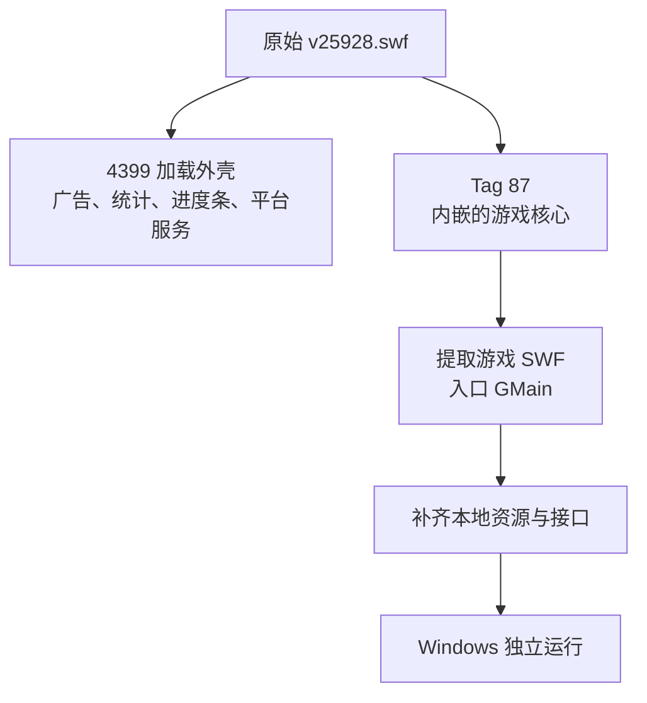
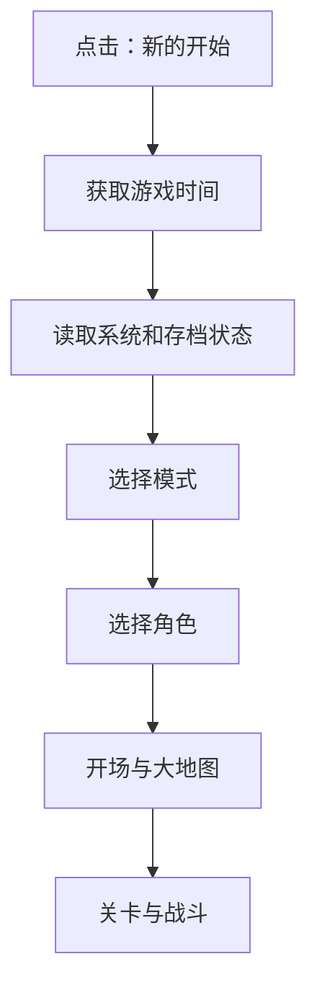
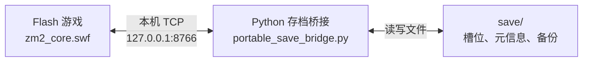

# dream-maker-jtw2-offline
# 造梦西游 2：十殿阎罗篇 · 离线单机还原项目

> 让经典 Flash 游戏在现代 Windows 电脑上尽可能保留原版体验：**脱离网页运行、完整加载游戏资源、使用本地存档，并通过真实操作验证可玩性。**

**项目状态：开发与测试中** · **平台：Windows** · **技术：Flash / ActionScript 3 / Python / PowerShell** · **资料更新：2026-10-10**

> [!IMPORTANT]
> 本项目已经完成原始游戏核心提取、主要资源整理，并取得独立启动与第一关基本操作的测试记录。**目前仍属于离线还原原型向可靠便携版过渡的阶段。**存档安全、完整通关、全部关卡和真正的“拷贝即玩”仍需继续验证。下文会明确区分已实现的功能、测试报告中的结论和已知问题。

## 📖 目录

- [项目是什么](#-项目是什么)
- [为什么要做这个项目](#-为什么要做这个项目)
- [目前做到了什么](#-目前做到了什么)
- [如何运行](#-如何运行)
- [项目文件结构](#-项目文件结构)
- [核心原理：让网页游戏脱离网页](#-核心原理让网页游戏脱离网页)
- [资源与关卡是如何恢复的](#-资源与关卡是如何恢复的)
- [原版玩法和逻辑修复](#-原版玩法和逻辑修复)
- [便携式存档如何工作](#-便携式存档如何工作)
- [自动化测试与真实完成度](#-自动化测试与真实完成度)
- [开发中踩过的坑](#-开发中踩过的坑)
- [已知问题与后续计划](#-已知问题与后续计划)
- [开发与验证说明](#-开发与验证说明)
- [常见问题](#-常见问题)
- [项目说明与致谢](#-项目说明与致谢)

---

## 🎮 项目是什么

《造梦西游 2：十殿阎罗篇》是一款经典的 4399 Flash 网页游戏。这个项目尝试把它整理为**可以在 Windows 本地独立运行的单机版本**，尽量保留当年的画面、音乐、角色、敌人、技能、关卡以及存档和解锁规则。

项目希望最后达到这样的效果：下载并解压已经准备好的合法游戏文件后，双击启动；从第一关正常游玩；退出游戏后进度保存在游戏文件夹中；以后把整个文件夹移到别的电脑，也能继续游戏。

为了尽量保持原汁原味，技术路线是**提取并修复原始 SWF 游戏核心，补齐其需要的资源和本地服务**。项目没有以重新绘制画面或重新编写整套战斗系统为目标。

### 项目目标

| 目标 | 通俗解释 |
| --- | --- |
| 忠实原版 | 人物、招式、伤害、掉落、地图锁定和通关条件尽量遵循原版 |
| 完整离线 | 运行时不依赖 4399 网页、广告或原在线存档服务 |
| 本地独立启动 | 不需要在浏览器里打开旧网页 |
| 资源完整 | 本地具备角色、场景、音乐、关卡等必要 SWF 文件 |
| 便携存档 | 存档放进游戏目录下的 `save/`，方便备份与迁移 |
| 自动验证 | 用真实 Windows 窗口和真实游戏流程测试，而不只检查脚本是否执行 |
| 不干扰电脑配置 | 尽量不改动系统代理、DNS、网络配置及原有 Flash 存档 |

## 💡 为什么要做这个项目

Flash 网页游戏通常有两部分：**游戏本体**和**网站提供的加载环境**。

《造梦西游 2》原本通过 4399 页面加载。游戏入口还涉及广告、进度条、统计、平台接口和额外资源。时间过去以后，就算拿到了原来的 `.swf` 文件，也可能遇到：

- 进度条卡住，始终进不了菜单；
- 缺少角色、音乐或关卡资源，打开后白屏；
- 能看到菜单，点击“新的开始”却没有反应；
- 可以进入游戏，却无法保存或继续；
- 为了调试而打开了开发模式，导致地图全部解锁、战斗画面出现“此处出怪”等文字。

项目就是围绕这些实际问题，一层一层修复。

## ✅ 目前做到了什么

### 已取得的主要成果

1. **找到真正的游戏核心**：从带有 4399 加载外壳的 `v25928.swf` 中提取出可独立启动的 `GMain` 游戏部分。
2. **整理原版外部资源**：梳理角色、美术、音频、背包、关卡和猪八戒扩展等 SWF 文件，建立资源清单。
3. **处理资源解密与本地加载**：为经过头部混淆的资源恢复加载方式，兼容已经是标准 SWF 的文件。
4. **排查主菜单、角色选择及存档事件**：修复过“新的开始”无响应、存档界面持续显示“处理中…”等问题。
5. **恢复正常游戏模式**：确认关键配置 `Config.isHideDebug = true`，防止开发调试逻辑改变地图和战斗规则。
6. **实现本地存档桥接原型**：让游戏通过本机 Socket 服务，将存档写入游戏目录内的 `save/` 文件夹。
7. **搭建真实 Windows 自动化流程**：已有启动、选角、进入第一关、输入操作、保存以及重新启动等测试记录。

### 当前状态一览

| 功能 | 目前情况 |
| --- | --- |
| 提取原版游戏核心 | 已完成提取并有初始化运行记录 |
| 整理主要依赖资源 | 已建立较完整的文件清单 |
| 显示菜单、独立启动 | 有实际运行记录 |
| “新的开始”与角色选择 | 新版本测试报告显示通过，仍需持续回归 |
| 第一关加载、角色操作 | 有运行及输入测试记录 |
| 原版地图锁定与调试文字 | 已定位重要配置并实施修复，需继续回归 |
| 本地 `save/` 写入 | 基础写入/读取已实现 |
| 退出后重新读取存档 | 报告显示通过，完整角色数据尚未逐项比对 |
| 多存档槽位和备份安全 | **存在已发现的缺陷** |
| 不依赖额外 Python 环境 | **尚未达到** |
| 第一关完整击败 BOSS 并结算 | **尚未充分验收** |
| 全部关卡、角色及隐藏内容 | **尚未完成系统性验收** |

**一句话概括：主要技术障碍已经突破，但发布一个稳定的完整单机版还需要继续打磨。**

---

## 🚀 如何运行

> [!WARNING]
> 以下操作适用于**已经准备好 `Zaomeng2_Standalone` 目录及所需游戏文件**的情况。当前提供的两份项目总结并未附带可供下载的完整游戏包，因此这里不能承诺仓库现有文件已经齐全。

### 运行环境

- Windows 操作系统；
- 可正常使用的独立 Flash 播放器，启动器预期路径为 `tools/flashplayer_32_sa.exe`；
- 项目所需的核心及外部 SWF 文件；
- **当前启动脚本还要求电脑能通过 `PATH` 找到 `python.exe`**，用于启动本地存档服务；
- PowerShell（历史启动器面向 Windows PowerShell 5.1 编写）。

独立 Flash 播放器属于历史软件，应了解其安全和维护风险；请使用来源可信、具有合法使用权的版本。不要为了运行游戏修改系统日期或全局网络设置。

### 启动步骤

1. 准备好整个 `Zaomeng2_Standalone/` 文件夹，不要单独移动其中某一个 SWF。
2. 确认 `tools/` 中的播放器、启动脚本和存档桥接程序都存在。
3. 双击 `Start_Game.bat`。
4. 启动器会尝试创建 `save/`，启动本地存档服务，再打开 Flash 游戏。
5. 在主菜单中选择“新的开始”，按原版流程选模式、选角色并进入游戏。
6. 通过游戏内保存功能保存进度，存档应写入游戏目录中的 `save/`。

**当前有一个重要限制：**如果存档服务未正确启动，游戏窗口仍有可能打开，但之后的保存和读取可能失败。正式版计划在打开游戏前加入可靠的服务就绪检查。

### 怎样备份存档

目前设计的存档位置是：

```text
Zaomeng2_Standalone/
├── zm2_core.swf
└── save/
    ├── slot_0.dat
    ├── slot_0.meta.json
    └── backups/
```

退出游戏后，可以先把整个 `save/` 文件夹复制到安全位置，再进行升级或测试。**在存档槽位隔离与损坏校验问题解决前，请额外保留手动备份。**

### 如何停止游戏

正常情况下优先关闭游戏窗口，让启动器负责清理本次运行的相关进程。

历史版本提供 `Stop_Game.bat`，但它使用过按程序名结束 Flash 进程的方式，可能影响电脑上其他同时运行的 Flash 程序。**这个脚本目前不建议作为常规退出方式。**

---

## 📁 项目文件结构

以下是**方案中预期的独立游戏目录**。它描述目标打包方式，不代表当前仓库已经包含所有这些文件。

```text
Zaomeng2_Standalone/
│
├── Start_Game.bat              # 双击启动入口
├── Stop_Game.bat               # 历史停止脚本（待改进）
├── zm2_core.swf                # 从原版提取并修改的游戏核心
│
├── OtherMat_v10.swf            # 主菜单、场景等美术资源
├── Role_v6.swf                # 角色资源
├── Common_v7.swf              # 公共游戏对象、特效等
├── Music.swf                  # 背景音乐与音效
├── backpack_v5.swf            # 背包、装备等资源
├── Pig9.swf                   # 猪八戒相关扩展资源
│
├── 1_v6.swf                   # 第一关资源
├── 2.swf                      # 第二关资源
├── 3.swf                      # 第三关资源
├── 4.swf                      # 第四关资源
├── 5_v7.swf                   # 第五关资源
├── 6.swf ... 11.swf           # 后续关卡资源（示意）
│
├── save/                       # 本地存档目录
│   ├── slot_0.dat              # 存档二进制内容
│   ├── slot_0.meta.json        # 存档元信息
│   └── backups/                # 存档备份
│
└── tools/
    ├── flashplayer_32_sa.exe  # 独立 Flash 播放器
    ├── launcher.ps1            # Windows 启动和进程管理
    └── portable_save_bridge.py # 本地存档服务
```

> `6.swf ... 11.swf` 是阅读方便的缩写，真实目录应使用一个个独立文件，不存在这个字面名称的文件。

## 🧩 核心原理：让网页游戏脱离网页

### 第一步：找到真正的游戏本体

最早拿到的是 `v25928.swf`。这个文件像一个“外包装”：一方面负责与 4399 环境交互，另一方面携带真正的游戏核心。

逆向分析发现，原始 SWF 内部的 `DefineBinaryData`（Tag 87）中嵌入了独立的游戏 SWF，入口类为 `GMain`。项目把这部分提取出来，作为后续离线运行和修复的基础。



这一步非常关键：游戏可以更直接地进入原始逻辑，减少对历史网页外壳的依赖。

### 提取出的原始核心有哪些特征？

以下数据来自项目历史归档：

| 项目 | 记录 |
| --- | --- |
| 原始带壳入口 | `v25928.swf`，2,325,796 字节 |
| 提取核心基线 | `zm2_core_standalone.swf`，2,283,576 字节 |
| 文档入口类 | `GMain` |
| Flash 格式 | SWF 15 |
| 开发技术 | ActionScript 3 / AVM2 |
| 舞台大小 | 940 × 590 |
| 帧率 | 24 FPS |
| 原始核心 SHA-256 | `e148a14c167bb972f52b68d26dc04cc4489c6b2f522fcf6eee2978239e7bbf8f` |

### 第二步：替换原先依赖网站的功能

网页游戏里有些看不见的功能需要向平台请求，比如取得游戏时间、读取存档列表、读取某个槽位、保存角色进度。

失去网站服务后，这些请求可能没有回应，主菜单和存档界面也会被卡住。因此项目对 `GMain`、`GameMenu`、`MemoryClass`、`SaveInter` 等相关代码进行了分析和离线适配。

目标是尽可能**保留原版游戏中的事件和状态转换**，让它们在没有旧服务器的情况下也能收到正确回应。

---

## 📦 资源与关卡是如何恢复的

游戏核心本身并不包含所有内容。人物、场景、音乐、背包以及每一关的部分资源，都存放在外部 SWF 中。

### 资源清单的三种口径

| 统计范围 | 数量 | 历史归档体积 | 含义 |
| --- | ---: | ---: | --- |
| 全量归档 | 23 个 SWF | 约 43.4 MiB | 含原入口、旧版或备用资源 |
| 直启闭包 | 21 个 SWF | 约 36.1 MiB | 独立直启方案涉及的资源集合 |
| 最小必需集 | 18 个 SWF | 约 33.3 MiB | 按当前分析去掉历史别名和备用包后的集合 |

以上是**文件审计口径**。文件齐全只能证明资源整理有进展，仍需进入游戏逐关验证功能。

### 主要资源分别做什么？

| 文件 | 用途 |
| --- | --- |
| `OtherMat_v10.swf` | 菜单、界面和部分美术素材 |
| `Role_v6.swf` | 游戏角色资源 |
| `Common_v7.swf` | 公共对象、特效与游戏类 |
| `Music.swf` | 游戏音乐和音效 |
| `backpack_v5.swf` | 背包、装备相关内容 |
| `Pig9.swf` | 猪八戒相关扩展内容 |
| `1_v6.swf` | 第一关 |
| `2.swf`～`4.swf` | 第二至第四关 |
| `5_v7.swf` | 第五关 |
| `6.swf`～`11.swf` | 后续关卡与特殊内容 |

历史包中还有 `1.swf`、`5.swf`、`Pig8.swf` 等备用或旧版名称。实际加载器会根据版本规则选择文件，例如第一关对应 `1_v6.swf`，第五关对应 `5_v7.swf`。

### 为什么有些 SWF 打不开？

项目发现部分资源经过了简单的文件头混淆。Flash 直接读取它们时，会把它们当成无效文件。

这里的修复思路是：

```text
读取资源文件
    │
    ├── 文件头已经是 FWS / CWS → 直接交给 Flash 加载
    │
    └── 文件头被处理过         → 按原版规则还原后再加载
```

其中一个相关报错是 `IOError #2124`，代表 Flash 无法将输入识别为有效的 SWF 内容。后来增加了“先检查文件头再决定是否解密”的方式，避免对已经解密的文件重复处理。

---

## 🛠️ 原版玩法和逻辑修复

### “新的开始”为什么曾经点不动？

玩家点击按钮后，游戏会连续执行几个步骤：获取时间、读取必要系统数据、展示单人或双人选择、选择角色，最后进入地图。



历史版本中，时间回调、空数据槽位、事件响应和服务初始化顺序都曾导致这个流程中断。运行日志还记录过 `ReferenceError #1065`，与重编译后使用定时器的方式有关。

后续改用 `Timer` / `TimerEvent` 处理异步回调，新版自动化开始记录到成功进入角色选择的结果。

### 存档界面为什么卡在“处理中…”？

游戏需要先发出读取存档列表的请求，再在响应回来时关闭等待窗口。如果响应来得太早，等待窗口还没有创建，关闭操作就可能落空；之后屏幕上会留下一个永远不会消失的“处理中…”。

项目通过调整响应时序和增加检查来修复这类问题。新的日志已经记录到 `SAVE_LIST` 事件和等待窗口移除。

### 为什么曾经出现全地图解锁和“此处出怪”？

一个重要的原版配置是：

```actionscript
Config.isHideDebug = true;
```

历史调试补丁曾把这个值改为 `false`。它会影响地图进度、技能、怪物刷新和开发标记显示等内容。重新恢复正常发布状态后，这些测试用的内容应被隐藏，地图也应遵循原版逐步解锁规则。

这件事提醒我们：**让游戏能够启动，同时还必须保证游戏规则没有被意外改掉。**

---

## 💾 便携式存档如何工作

### 为什么需要自己的存档系统？

传统 Flash 游戏常通过 `SharedObject` 将存档写入 Windows 用户配置目录。这样一来，只复制游戏文件夹，存档未必能跟着走。

为方便备份和迁移，项目新增了本地存档桥接服务：



这条连接只设计给本机使用。项目选择原生 Socket 通信，是因为开发环境中曾遇到 Flash 本地 HTTP 请求与系统代理冲突的情况；这种方案无需为了存档去改动 Clash Verge 或全局代理设置。

### 桥接服务主要做什么？

| 请求 | 功能 |
| --- | --- |
| `helo` | 游戏和桥接服务相互确认连接信息 |
| `time` | 获取时间 |
| `list` | 查看已有存档槽位 |
| `save` | 把存档二进制内容写入文件 |
| `load` | 从文件读取指定槽位 |

游戏侧计划通过 ActionScript 的对象序列化保留角色数据，桥接程序接收并保存对应的二进制数据。**当前桥接程序本身没有验证所有 AMF3 对象字段是否完整、能否被游戏正确恢复**，这部分还要开展端到端验收。

### 当前最需要注意的存档问题

代码检查与历史测试明确指出：

- 某些非法槽位编号仍会被接受；
- **系统槽位 6 和 7 曾映射到同一个 `system.dat`，存在互相覆盖风险**；
- 空存档数据可能被当成成功写入；
- 文件损坏或被篡改后，读取流程没有可靠地拒绝数据；
- 同一秒进行多次备份，可能出现同名覆盖；
- 存档文件和元数据分开更新，异常中断时可能不一致；
- 通信协议仍需进一步限制输入大小和调用权限。

因此，现阶段**不要把实验性存档服务当作唯一可靠的长期存档保管方式**。测试前后建议自己再备份一份 `save/`。

---

## 🧪 自动化测试与真实完成度

### 为什么一定要用真实窗口测试？

开发早期，曾出现测试脚本报告成功，但实际点击“新的开始”仍然没有反应的情况。后来发现，个别测试只验证了 Python 内的模拟逻辑，甚至可能不启动 Flash 就输出成功状态。

所以项目后来改为：让自动化程序真正打开 Flash Player、操作实际游戏窗口、观察界面变化、检查磁盘上的存档，并在关闭游戏后重新启动读取。


历史自动化涉及 Windows 窗口控制、按键输入、截图、Flash Trace、进程号以及文件哈希等证据。

### 关于报告中的“16/16 PASS”

**2026 年 10 月 10 日**的便携版测试报告将 **16/16 项标记为 PASS**，并记录了两次不同进程的启动、部分主菜单与第一关操作、存档文件以及冷启动读取。另一份总结还列有九张取证截图的目录。

这些数据说明项目进入了真实运行验证阶段，**但目前不能据此宣布《造梦西游 2》全游戏完整通关或所有功能都已修好**。原因包括：

- 16 项中还包括进程、脚本、端口和环境检查；
- 第一关测试主要记录按键发送与场景流程，没有充分证明 BOSS 被击败、结算完成和下一关自然解锁；
- 存档恢复缺少装备、技能、背包、经验、关卡进度等字段的完整对照；
- 两份重复的验收材料不能算成两次独立测试；
- 对存档桥接程序的代码检查已经找到了实际缺陷。

### 我们希望怎样判断“测试通过”？

| 容易误判的检查 | 更可靠的通过标准 |
| --- | --- |
| 点击按钮的指令已发送 | 对应界面真的出现、状态真的改变 |
| 第一关 SWF 文件已找到 | 场景、玩家、敌人确实创建成功 |
| 攻击按键已按下 | 敌人真正受到伤害、生命值发生变化 |
| 保存函数返回成功 | 数据正确落盘，并且能通过完整性检查 |
| 重新打开“继续游戏” | 退出前后的角色字段全部一致 |
| 所有关卡文件存在 | 每关实际可加载、结算和自然解锁 |

最终验收还需要确保：**用于测试的文件与提供给玩家下载的文件完全一致**，可以通过 SHA-256 核对。

---

## 🐛 开发中踩过的坑

| 现象 | 排查发现 | 处理或当前建议 |
| --- | --- | --- |
| 旧网页加载条卡住 | 平台事件、广告、跨域请求依赖 | 提取 `GMain` 核心，减少网页外壳依赖 |
| `SecurityError #2048` | Flash 网络安全沙箱或跨域限制 | 减少旧网站请求，改为本地资源与接口 |
| `IOError #2124` | 外部 SWF 文件头无效或重复解密 | 识别 `FWS/CWS` 再决定是否还原 |
| “新的开始”无响应 | 时间回调、存档系统数据或异步事件中断 | 修复服务回调及定时器逻辑 |
| “处理中…”弹窗不关闭 | 请求响应与弹窗创建顺序冲突 | 调整异步事件顺序并加强检查 |
| 地图全部解锁 | `Config.isHideDebug` 被错误改为 `false` | 恢复发布模式 `true` |
| 战斗中显示“此处出怪” | 原版内部开发标记暴露 | 恢复发布模式并检查地图资源 |
| 诊断版闪退、`Error #1009` | 某些对象初始化顺序不正确 | 检查 `GMain` 单例与资源加载器时序 |
| Flash 本地 HTTP 请求失败 | 历史环境的系统代理/WinINet 冲突 | 使用本机 TCP Socket 存档桥接 |
| Flash 打开后白屏，路径末尾多出 `"` | PowerShell 启动参数转义错误 | 检查参数传递，不在路径尾部产生多余引号 |
| 批处理乱码 | Windows CMD / PowerShell 编码差异 | 历史方案采用 BAT 纯 ASCII、PS1 UTF-8 BOM |
| 测试全部 PASS，实际仍有故障 | 模拟断言无法代表真实游戏运行 | 使用真实窗口和可复现的游戏状态断言 |

此外，历史总结提到部分 Flash Player 32 版本的停用机制（EOL 限制）。播放器的选择应以**安全、合法、经过实际验证的本地运行环境**为准；这里不提供绕过安全更新或更改系统日期的操作。

---

## 🗺️ 已知问题与后续计划

### P0：先保证不丢存档

- [ ] 限制存档槽位范围，拒绝非法编号和无效空数据。
- [ ] 查清系统槽位 6、7 的原版用途，改为互相独立的存储方式。
- [ ] 读取时校验哈希和基本数据格式，发现损坏立即报错。
- [ ] 避免备份文件重名覆盖，并保证存档与元数据一致更新。
- [ ] 验证所有角色状态保存、退出、重新打开后都逐字段一致。

### P0：让启动与退出稳定可靠

- [ ] 启动前检查 `127.0.0.1:8766` 的服务握手，失败时给出明确提示。
- [ ] 只结束本次启动的 Flash 和存档桥接进程，避免误伤其他程序。
- [ ] 验证最终交付 SWF 与被测 SWF 的 SHA-256 一致。
- [ ] 用完整断网环境重复运行启动、保存和读取流程。

### P1：做到真正绿色便携

- [ ] 把 Python 存档服务打包成独立程序，或随包提供固定的运行环境。
- [ ] 在不预装 Python 的干净 Windows 环境中验证一键启动。
- [ ] 整个文件夹移动位置后，验证原来的存档可以继续使用。

### P1：完成第一关的真正通关闭环

- [ ] 验证移动、跳跃、攻击与技能在游戏里产生实际效果。
- [ ] 验证怪物刷新、受到伤害及死亡流程。
- [ ] 完成 BOSS 战、关卡结算和下一关解锁。
- [ ] 通关之后保存、退出，再进入游戏确认进度仍然正确。

### P2：全游戏忠实度验收

- [ ] 逐关验证已收集的关卡资源。
- [ ] 检查角色、猪八戒相关内容及各自技能。
- [ ] 检查装备、背包、掉落、金钱/灵魂等数值状态。
- [ ] 检查隐藏内容、解锁条件、剧情与正常结算。
- [ ] 重复运行完整自动化测试，保留截图、日志和文件校验结果。

### 发布目标

| 阶段 | 完成标准 | 当前判断 |
| --- | --- | --- |
| **Level 1：基础可玩版** | 能启动、创建角色并进入第一关，基本操作正常 | 接近达成，需对交付版回归 |
| **Level 2：可靠便携版** | 稳定存档、正确读档、文件夹迁移、一键安全运行 | 尚需重要修复 |
| **Level 3：完整忠实还原版** | 全关卡、全流程和原版规则系统性验证完成 | 尚未验收 |

---

## 🔧 开发与验证说明

### 主要技术与工具

| 技术 / 工具 | 项目中的用途 |
| --- | --- |
| SWF / ActionScript 3 | 游戏本体与业务逻辑 |
| AVM2 / DoABC | 分析和修改 Flash 字节码 |
| FFDec | 查看 SWF 资源和反编译 ActionScript |
| Python | 资源检查、自动化、存档桥接、测试脚本 |
| Win32 API | 自动化控制 Windows 游戏窗口 |
| PowerShell / BAT | 启动与进程管理 |
| SHA-256 | 检查版本、构建文件和存档是否一致 |

历史材料还提到 `game_state_probe.py`、`sol_save_manager.py`、`verify_diagnostic_swf.py`、`stage1_acceptance_runner.py` 等验证工具。**其名称来自开发过程记录，不代表这些文件当前已全部包含在公开仓库。**

### 必须保护的环境与数据

开发和自动化测试应当遵守以下约束：

- 不擅自修改系统代理、Clash Verge、DNS 或 Windows 全局网络配置；
- 不覆盖原有 Flash `.sol` 存档；
- 不用“测试脚本正常退出”代替游戏功能验收；
- 不把构建目录中的一个 SWF 的测试结果套用到不同 SHA-256 的交付文件；
- 修改存档协议前先备份数据，并在独立测试目录中验证。

### 版本身份与可追溯性

同一个 `zm2_core.swf` 文件名，在不同阶段曾对应不同版本。历史报告记录的最新版便携核心 SHA-256 为：

```text
8784ae7f36b8e2714e5d4daa4a5688ba93b3c6039163202e27d7d322e6bb743c
```

这是**历史测试报告所记录的哈希**。由于本次整理所依据的附件是项目总结文档，未提供该版本的实际 SWF 文件，所以这里没有重新计算并核实它。

建议今后每个 Release 附带：实际产物的 SHA-256、资源清单与哈希、测试日期、运行环境、测试结果、已知问题及完整验收日志。

---

## ❓ 常见问题

<details>
<summary><strong>这个项目现在已经能完整通关了吗？</strong></summary>

目前还没有足够的测试证据支持“全游戏已经完整通关”。第一关基本流程有运行记录，BOSS、结算、后续关卡、隐藏内容还需要进一步验收。

</details>

<details>
<summary><strong>为什么不能只下载一个 SWF？</strong></summary>

游戏的角色、音乐、背包和关卡等内容分散在多个外部资源文件中。缺少某些 SWF，游戏可能打开菜单却无法正常进入场景，或在加载时出错。

</details>

<details>
<summary><strong>游戏存档在哪里？</strong></summary>

当前便携化方案将存档写入游戏主文件同级的 `save/` 目录。请注意，旧版本还可能使用 Flash 默认 `.sol` 存档系统，不能混为一谈。

</details>

<details>
<summary><strong>复制整个文件夹到另一台电脑，能直接玩吗？</strong></summary>

这是最终目标。目前启动器还依赖目标电脑上的 Python，文件夹迁移及完整读档也需要更多测试，因此尚未达到对所有干净 Windows 电脑“复制即玩”的承诺。

</details>

<details>
<summary><strong>还需要连接 4399 吗？</strong></summary>

项目设计目标是全离线，不依赖 4399 原网站。当前架构已经围绕本地 SWF 和本地存档服务展开，但完整断网回归测试尚未充分完成。

</details>

<details>
<summary><strong>会修改我的网络代理或 Clash Verge 设置吗？</strong></summary>

项目明确以不改动这些设置为开发约束，存档桥接使用本机 Socket 通信。实际使用任何新的启动器或测试工具前，仍应检查其代码和行为。

</details>

<details>
<summary><strong>为什么下载了完整资源，还是不代表完全修好？</strong></summary>

资源存在、程序能打开、人物能行动，只覆盖游戏的一部分。还要验证战斗判定、关卡结算、存档恢复、装备技能和各种解锁条件，才能评价原版玩法是否完整。

</details>

---

## 📜 项目说明与致谢

本项目聚焦经典 Flash 游戏的**研究、保存、逆向分析、离线运行和兼容性改造**。游戏名称、人物、画面、音乐及原始游戏资源的权利归其相应权利人所有。

是否能够公开分发原版 SWF、修改版游戏资源、Flash 播放器或完整可执行游戏包，应依据相应著作权、软件许可证和分发权限决定。**本 README 不代表这些内容已获得再分发授权。**仓库是否采用开源许可证、哪些自编工具可以开源，需要根据实际文件和权属另行明确。

项目研究过程中使用或参考了 Flash/SWF 逆向分析、FFDec、Flashpoint 和 Windows 自动化等技术路线。感谢经典游戏开发者、资料保存者及参与验证的人员。

### 关于本文信息的来源

本 README 根据截至 **2026 年 10 月 10 日**的两份项目内部总结整理：

- `造梦西游2_项目完整总结与技术复盘(1).md`：较详细记录了项目历程、资源分析、已发现缺陷、完成度评估及验收边界。
- `PROJECT_SUMMARY.md`：重点记录了便携版架构、代理冲突、启动器编码、自动化测试及阶段性成果。

两份材料对“完成程度”的描述有差异。本文采用**审慎、可复现的证据标准**：对尚未独立核验的功能保留原报告结论，同时明确列出已发现的缺陷和仍待验证的工作。

---

<p align="center"><strong>让经典作品重新运行，也让每一项“修复完成”都经得起真实游玩验证。</strong></p>
